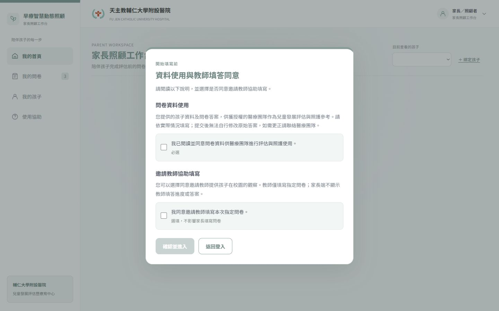
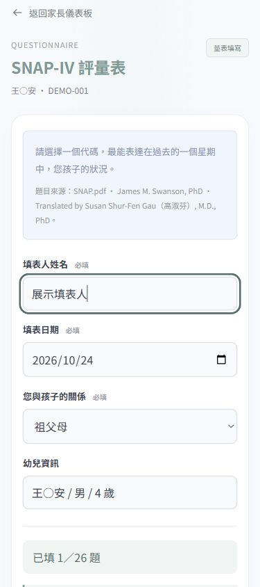
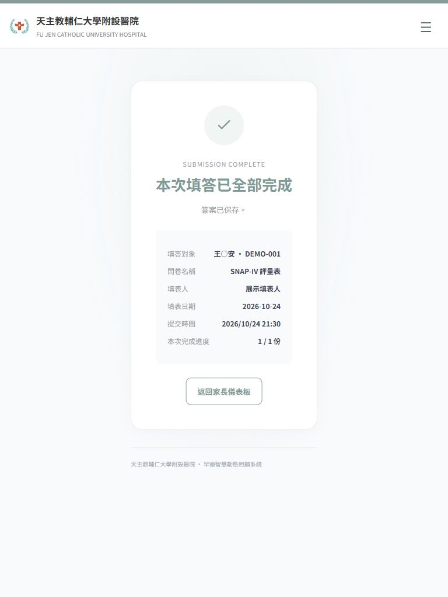

# 10/28 家長端展示操作清單

查核日期：2026/10/24。此文件是操作與驗收清單，不含報告講稿。

## 固定入口與資料

- 專案：`Smart-Early-Intervention-Frontend-Integration`，分支 `feature/case-guardian-management`。
- 開啟 <http://localhost:5177/parent-workspace.html>；沿用現有工作台，不使用其他展示頁。
- 虛構孩子：王○安，`DEMO-001`；指定家長 SNAP-IV 評量表，共 26 題。
- 此入口展示資料存於同一瀏覽器、同一 Origin 的 localStorage。正式帳號入口為 `?mode=account`，兩者不能混稱。
- 2026/10/24 彩排後，這份展示問卷已重新開啟為未填，前次內容保留一份備份；入口停在未勾選的同意視窗。

網站未啟動時，在專案根目錄的 PowerShell 執行（維持視窗開啟）：

```powershell
dotnet run --project EarlyInterventionCare.Api/EarlyInterventionCare.Api.csproj --no-launch-profile -p:BaseOutputPath=C:/Users/ashle/AppData/Local/Temp/earlycare-1028-api-build/ -- --environment Development --urls http://localhost:5177
```

若 5177 已有服務，直接使用既有服務，不重複啟動。上述命令不執行 Migration。

## 完整彩排

| 步驟 | 操作 | 預期結果 |
|---|---|---|
| 1 | 從使用者選單登出，再進入固定入口 | 顯示同意視窗；未勾選必選項前無法進入；背景不先載入孩子資料 |
| 2 | 勾選資料使用；教師參與可不勾 | 可進入家長工作台，教師選項不阻擋家長填答 |
| 3 | 開始填寫 SNAP-IV | 顯示指定孩子、固定問卷；關係預設「請選擇」 |
| 4 | 填姓名、日期，選祖父母，僅答第 1 題 | 關係包含父親、母親、祖父母、其他親屬、其他；進度 1/26 |
| 5 | 按「先存起來，下次再填」，返回工作台 | 草稿 1 份；再次進入可還原姓名、日期、關係與答案 |
| 6 | 未答完按「檢查並送出」 | 提醒第 2 題未填並移至該題，不顯示成功 |
| 7 | 填完 26 題，檢查並確認送出 | 顯示完成資訊；回工作台待填 0、草稿 0、已提交 1 |
| 8 | 重新載入工作台 | 同一瀏覽器仍保留完成狀態 |

## 手機、平板與桌面

- 手機 390×844：醫院中英文與選單維持單一頁首；關係可操作；選項直排，無頁面水平溢出。
- 平板 768×1024：問卷與提交確認可操作；完成畫面無水平溢出。
- 桌面 1440×900：保留側欄及原工作台布局。
- 實機仍須於會前確認觸控、鍵盤、瀏覽器與現場網路；尺寸模擬不能取代實機驗收。

## 下次重新試填

「我的問卷」→「試填問卷」→「確認重新填寫」。只重新開啟此份家長 SNAP-IV，並保留一份舊內容備份，不清除所有瀏覽器資料，也不影響教師資料。這是展示重試功能，不代表正式重填政策已核准。

需重新展示同意視窗時，使用選單「登出」後再開啟固定入口。不要假裝已通過正式 Email 登入。

## 展示範圍與正式流程界線

- 本次彩排為現有前端展示流程；同意選擇與問卷結果不是正式資料庫紀錄。
- V5.3 的 Consent、JWT、Guardian、專用 API 另有 SQLite／Fake Gateway 隔離測試。
- 正式 Email 登入啟用、核准同意本文、共用寫入 Gateway、Migration 與真實 MySQL 全流程仍待整合。
- API 失敗不可回退 localStorage 冒充正式成功；正式 Gateway 未接妥維持 503。
- 不使用真實病患資料，不在展示前執行 Migration 或臨時合併其他分支。
- 建議 10/27 依本清單再彩排一次，保留這次本機 Commit 作為可回溯基準。

## 截圖證據






